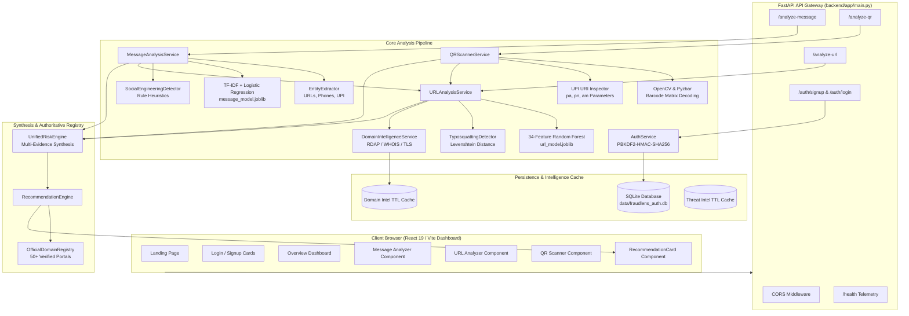
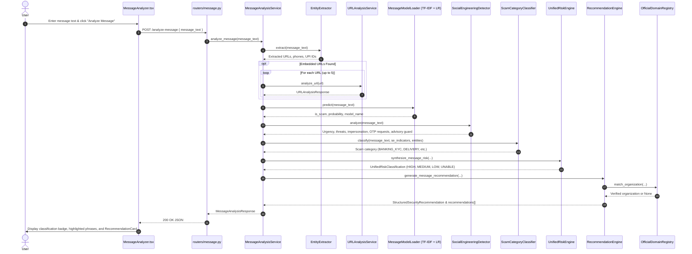
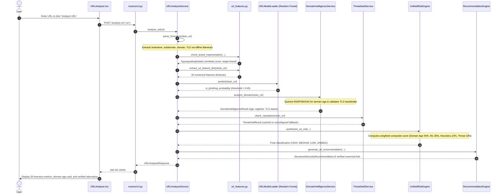
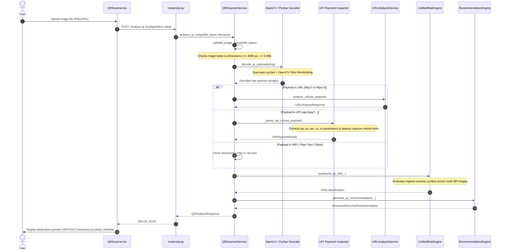
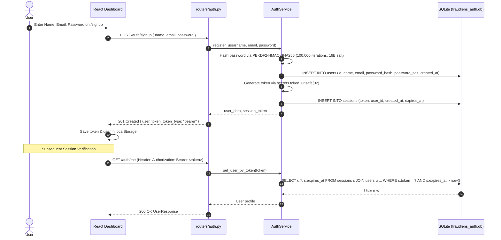

# FraudLens — Complete Codebase Audit, System Architecture & Developer Walkthrough

**Document Version:** 1.0.0  
**Project Root:** Repository Root (`.`)  
**Target Audience:** Developers, Technical Evaluators, Academic Reviewers & Viva Panels  
**Last Verified:** October 2026  

---

## TABLE OF CONTENTS
1. [Part 1 — Project Overview](#part-1--project-overview)
2. [Part 2 — Complete Project Folder Structure](#part-2--complete-project-folder-structure)
3. [Part 3 — Main Files and Their Functionality](#part-3--main-files-and-their-functionality)
4. [Part 4 — System Architecture and Request Flow](#part-4--system-architecture-and-request-flow)
   - [4.A Scam Message Detection Workflow](#4a-scam-message-detection-workflow)
   - [4.B Phishing URL Detection Workflow](#4b-phishing-url-detection-workflow)
   - [4.C QR Code Safety Scanner Workflow](#4c-qr-code-safety-scanner-workflow)
   - [4.D Authentication and Session Architecture](#4d-authentication-and-session-architecture)
   - [4.E Unified Risk Engine & Scoring Formulas](#4e-unified-risk-engine--scoring-formulas)
5. [Part 5 — Database: How to Find, Open, and Inspect It](#part-5--database-how-to-find-open-and-inspect-it)
6. [Part 6 — Machine Learning: Complete Technical Deep Dive](#part-6--machine-learning-complete-technical-deep-dive)
7. [Part 7 — API Endpoint Reference](#part-7--api-endpoint-reference)
8. [Part 8 — How to Run the Project](#part-8--how-to-run-the-project)
9. [Part 9 — Testing, Debugging, and Troubleshooting](#part-9--testing-debugging-and-troubleshooting)
10. [Part 10 — Security and Privacy Review](#part-10--security-and-privacy-review)
11. [Part 11 — Comprehensive Viva & Technical Interview Preparation](#part-11--comprehensive-viva--technical-interview-preparation)
12. [Part 12 — Verified Implementation Invariants & Known Limitations](#part-12--verified-implementation-invariants--known-limitations)
13. [“Start Here” Quick Reference](#start-here-quick-reference)

---

# PART 1 — PROJECT OVERVIEW

### 1. The Problem FraudLens Solves
Modern cyber fraud and digital social engineering operate across fragmented communication vectors: SMS phishing (smishing), fraudulent web links, and malicious optical QR codes. Attackers frequently exploit cognitive vulnerabilities—such as artificial urgency, coercive legal or account-suspension threats, brand impersonation, and typosquatting—often registering lookalike domains minutes before launching attacks.

Existing defenses are typically fragmented: email filters miss SMS messages, desktop antivirus does not parse optical payment QR codes, and basic URL blocklists fail against newly registered domains. Furthermore, generic warnings ("Be careful with links") fail to guide victims toward authentic services. 

**FraudLens** bridges these defense silos into a unified, privacy-first, explainable digital fraud analysis platform that assesses risks across messages, web addresses, and QR barcodes, outputting transparent evidence, explainable indicators, and verified safe destinations.

### 2. Intended Users and Use Cases
- **General Consumers / Banking Customers:** Inspect suspicious SMS notifications, courier tracking links, and physical QR codes (e.g. UPI parking or restaurant stickers) to verify legitimacy before clicking or authorizing payments.
- **Enterprise / Security Analysts:** Perform rapid, offline triage on suspected phishing campaigns and brand impersonation lures without executing malicious payloads or exposing IP addresses.
- **Academic & Educational Demonstrations:** Illustrate the combination of statistical machine learning, lexical feature extraction, deterministic heuristic guards, and authoritative domain registries.

### 3. The Three Main Detection Modules
1. **Scam Message Detection:** Natural Language Processing (NLP) pipeline combining a TF-IDF + Logistic Regression statistical classifier, a deterministic social engineering heuristic engine (detecting urgency, financial threats, prize bait, OTP demands, and authority impersonation), character-level phrase highlighting, entity extraction (URLs, phone numbers, UPI VPAs), and automatic embedded URL routing.
2. **Phishing URL Detection:** Structural inspection combining a 34-dimensional lexical Random Forest model, Levenshtein-distance typosquatting detection against 30+ major financial and consumer brands, offline public suffix domain parsing via `tldextract`, RDAP/WHOIS domain age calculation, TLS certificate validation, external threat intelligence feeds, and verified official domain matching.
3. **QR Code Safety Scanner:** Optical computer vision pipeline utilizing OpenCV and Pyzbar to decode 2D matrix barcodes, classify payloads into recognized schemes (URL, UPI payment, Wi-Fi, vCard, Plain Text), safely preview hidden destinations without execution, inspect UPI payment parameters (`pa`, `pn`, `am`), and route web links into the phishing analysis engine.

### 4. Technologies Actually Used
- **Frontend Dashboard:** React 19, TypeScript 5.x, Vite 6.x, Tailwind CSS 3.4, Lucide React icons.
- **Backend API Gateway:** Python 3.14, FastAPI 0.115+, Uvicorn (ASGI server), Pydantic v2 (strict request/response validation).
- **Machine Learning & Data Science:** Scikit-learn 1.4+, Pandas, NumPy, Joblib.
- **Computer Vision & Image Processing:** OpenCV (`opencv-python` headless), Pyzbar, Pillow (PIL).
- **Domain & Network Intelligence:** `tldextract` (configured for offline local cache), `python-dateutil`, `requests`, Python native `ssl` and `socket`.
- **Database:** Native SQLite 3 via Python standard library `sqlite3` (no external database server required).

### 5. Machine Learning Models Actually Loaded and Used
1. **Scam Message Classifier (`backend/models/message_model.joblib`):**
   - **Type:** Scikit-learn `Pipeline(TfidfVectorizer, LogisticRegression)`.
   - **Hyperparameters:** `ngram_range=(1, 2)`, `lowercase=True`, `max_features=10000`, `sublinear_tf=True`, `C=5.0`, `class_weight='balanced'`, `solver='lbfgs'`.
   - **Artifact Size:** ~170 KB.
2. **Phishing URL Classifier (`backend/models/url_model.joblib`):**
   - **Type:** Scikit-learn `RandomForestClassifier`.
   - **Hyperparameters:** `n_estimators=150`, `max_depth=30`, `min_samples_split=4`, `class_weight='balanced_subsample'`, `random_state=42`.
   - **Input:** 34 handcrafted lexical and structural numerical features extracted from the URL string.
   - **Artifact Size:** ~9.5 MB.
3. **QR Code Analysis:**
   - **Important Architectural Fact:** QR decoding is **pure computer vision and deterministic rule parsing**, NOT machine learning. Decoded URLs are subsequently evaluated by the URL Random Forest model.

### 6. Database Technology Actually Configured
- **Engine:** SQLite 3.
- **File Location:** `data/fraudlens_auth.db`.
- **Scope:** Dedicated strictly to user authentication and session management. Analysis results are processed statelessly and are **not** persisted to the database.

### 7. Main External Services and APIs Used
- **RDAP (Registration Data Access Protocol):** `https://rdap.org/domain/{domain}` used to query authoritative domain registration and creation timestamps.
- **WHOIS Fallback:** Native socket-based WHOIS protocol querying top-level registrars when RDAP is unavailable.
- **Threat Intelligence Adapters:** Optional adapters for VirusTotal API v3 and URLScan.io API v1 in `backend/app/services/threat_intel.py`. Defaults to `THREAT_INTEL_ENABLED = False` for offline privacy and local execution without requiring API keys.

### 8. Authentication Mechanism
- Server-side PBKDF2-HMAC-SHA256 password hashing with a 16-byte cryptographically secure salt (`secrets.token_bytes(16)`) and 100,000 iterations.
- Constant-time verification using `hmac.compare_digest`.
- 32-byte cryptographically random session tokens (`secrets.token_urlsafe(32)`) with a 7-day expiration stored in the SQLite `sessions` table.
- Frontend hash router route-guard in `App.tsx` redirects unauthenticated users to `/login`.

### 9. Risk Engine and Four-Level Taxonomy
FraudLens outputs exactly one of four canonical risk classifications:
1. **`HIGH RISK`** — Definitive malicious indicators: confirmed threat intel match, severe heuristic (e.g. raw IP host or brand typosquatting combined with credential lures), or high-confidence ML prediction (`prob >= 0.60`).
2. **`MEDIUM RISK`** — Suspicious structural anomalies: moderate ML confidence (`0.25 <= prob < 0.60`), brand typosquatting without credential theft cues, newly registered domain (<= 30 days old), or coercive social engineering indicators.
3. **`LOW RISK`** — Authoritative domain verified, or clean ML/heuristic evaluation. *(Note: Low Risk is an absence of threat signals, not an absolute warranty of safety).*
4. **`UNABLE TO VERIFY`** — Incomplete inputs, corrupt image, unreadable QR matrix, or missing ML model artifacts (safe fail-over).

### 10. Most Important Limitations of the Current Implementation
1. **Stateless Analyses:** Analysis reports and scan histories are not stored in SQLite; closing the browser resets the dashboard view.
2. **Static Optical QR Inspection:** Scans uploaded static images (PNG, JPEG, WEBP, BMP); real-time camera streaming is not implemented.
3. **External Rate Limits:** Public RDAP endpoints (`rdap.org`) can be rate-limited or timeout on rapid repeated lookups (mitigated by an in-memory 24-hour TTL cache).
4. **Backend Route Openness:** Backend detection endpoints (`/analyze-message`, `/analyze-url`, `/analyze-qr`) are public/open at the HTTP layer; authentication guards are enforced on the frontend dashboard.

---

# PART 2 — COMPLETE PROJECT FOLDER STRUCTURE

```
fraudlens/
├── .env.example                          # Environment variable configuration template
├── .gitignore                            # Exclusions for virtual environments, caches, models
├── README.md                             # High-level overview and stage verification log
│
├── backend/                              # FastAPI Backend Application Root
│   ├── app/                              # Application Package
│   │   ├── __init__.py                   # Package initialization
│   │   ├── config.py                     # Pydantic BaseSettings (runtime configuration)
│   │   ├── main.py                       # FastAPI application bootstrap & CORS setup
│   │   │
│   │   ├── routers/                      # HTTP Route Controllers
│   │   │   ├── __init__.py               # Router exports
│   │   │   ├── auth.py                   # /auth/signup, /auth/login, /auth/me, /auth/logout
│   │   │   ├── health.py                 # GET /health subsystem telemetry
│   │   │   ├── message.py                # POST /analyze-message endpoint
│   │   │   ├── url.py                    # POST /analyze-url endpoint
│   │   │   └── qr.py                     # POST /analyze-qr endpoint
│   │   │
│   │   ├── schemas/                      # Pydantic v2 Contract Schemas
│   │   │   ├── __init__.py               # Schema exports
│   │   │   ├── auth.py                   # User registration, login, profile schemas
│   │   │   ├── common.py                 # UnifiedRiskClassification, Evidence items, Recommendations
│   │   │   ├── message.py                # Message request/response, findings, phrases
│   │   │   ├── url.py                    # URL request/response, forensics, typosquatting, intel
│   │   │   └── qr.py                     # QR request/response, UPI details, decoded items
│   │   │
│   │   └── services/                     # Business Logic, Forensics & Inference Services
│   │       ├── __init__.py               # Service exports
│   │       ├── auth_service.py           # SQLite authentication, PBKDF2 hashing & sessions
│   │       ├── domain_intelligence.py    # RDAP/WHOIS lookup, domain age & TLS inspection
│   │       ├── entity_extractor.py       # Regex span extraction for URLs, phones, UPI IDs
│   │       ├── message_model_loader.py   # Joblib loader & inference for SMS classifier
│   │       ├── message_service.py        # Message analysis coordinator
│   │       ├── official_registry.py      # Directory of 50+ verified official organization domains
│   │       ├── qr_service.py             # OpenCV/Pyzbar decoder, UPI inspector, QR coordinator
│   │       ├── recommendation_engine.py  # Context-aware 4-section guidance generator
│   │       ├── risk_engine.py            # UnifiedRiskEngine multi-evidence synthesis
│   │       ├── scam_category.py          # Behavioral typology classifier (KYC, Job, Lottery)
│   │       ├── social_engineering.py     # Rule-based psychological coercion detector
│   │       ├── threat_intel.py           # VirusTotal & URLScan adapters with TTL caching
│   │       ├── url_features.py           # 34 lexical feature extractors & typosquatting
│   │       ├── url_model_loader.py       # Joblib loader & inference for URL Random Forest
│   │       └── url_service.py            # URL analysis coordinator
│   │
│   ├── models/                           # Serialized Machine Learning Artifacts
│   │   ├── message_model.joblib          # Trained SMS TF-IDF + Logistic Regression pipeline
│   │   ├── message_model_metadata.json   # Model hyperparameters, training data & metrics
│   │   ├── url_model.joblib              # Trained URL Random Forest classifier
│   │   └── url_model_metadata.json       # Feature order, hyperparameters, metrics & thresholds
│   │
│   ├── scripts/                          # Dataset Preparation & Model Training Scripts
│   │   ├── inspect_sms_raw.py            # Diagnostic inspection of raw SMS data
│   │   ├── inspect_url_raw.py            # Diagnostic inspection of raw URL data
│   │   ├── prepare_sms_dataset.py        # Cleaning, deduplication & splitting of SMS data
│   │   ├── prepare_url_dataset.py        # Cleaning, deduplication & splitting of URL data
│   │   ├── train_sms_model.py            # Training pipeline for message classifier
│   │   └── train_url_model.py            # Training pipeline for URL Random Forest
│   │
│   └── tests/                            # Pytest Test Suites (225 passing tests)
│       ├── test_auth.py                  # User registration, login, hashing & session tests
│       ├── test_contracts.py             # Pydantic schema validation & risk taxonomy tests
│       ├── test_dataset_sms.py           # SMS data preparation integrity tests
│       ├── test_dataset_url.py           # URL data preparation integrity tests
│       ├── test_domain_intelligence.py   # RDAP, WHOIS, domain age & TLS tests
│       ├── test_e2e_stage8.py            # End-to-end integration across all subsystems
│       ├── test_end_to_end_scam_scenarios.py # Scenario benchmark tests
│       ├── test_entity_extraction.py     # URL, phone, UPI regex extraction tests
│       ├── test_health.py                # Telemetry & branding contract tests
│       ├── test_message_model.py         # Message model inference & edge case tests
│       ├── test_phrase_highlighting.py   # Exact character offset span tests
│       ├── test_qr_scanner.py            # CV decoding, UPI parameters, image validation tests
│       ├── test_recommendation_engine.py # Context-aware guidance & official registry tests
│       ├── test_risk_engine.py           # Multi-evidence synthesis & override tests
│       ├── test_scam_category.py         # Typology classification tests
│       ├── test_services.py              # Service dependency injection tests
│       ├── test_social_engineering.py    # Persuasion heuristic tests
│       ├── test_threat_intel.py          # Threat feed cache & adapter tests
│       ├── test_url_api.py               # /analyze-url endpoint tests
│       ├── test_url_features.py          # 34 lexical feature extraction tests
│       └── test_url_model.py             # Random Forest inference tests
│
├── data/                                 # Datasets and Runtime Database
│   ├── fraudlens_auth.db                 # SQLite 3 Database (Users & Sessions)
│   ├── raw/                              # Original source datasets
│   │   └── sms/SMSSpamCollection         # UCI SMS Spam Collection
│   └── processed/                        # Stratified splits & feature caches
│       ├── sms/                          # sms_train.csv, sms_val.csv, sms_test.csv
│       └── urls/                         # url_train.csv, url_val.csv, url_test.csv
│
├── docs/                                 # Architecture & Technical Documentation
│   ├── architecture.md                   # System architecture and sequence designs
│   ├── datasets.md                       # Data provenance and collection protocols
│   ├── implementation-plan.md            # System modules and architectural specifications
│   └── FRAUDLENS_TECHNICAL_GUIDE.md      # Authoritative Codebase & Technical Walkthrough
│
└── frontend/                             # React 19 Frontend Dashboard
    ├── index.html                        # HTML entry point
    ├── package.json                      # Dependencies and npm scripts
    ├── vite.config.ts                    # Vite build configuration & proxy settings
    ├── tailwind.config.js                # Tailwind CSS theme, fonts, and colors
    ├── src/
    │   ├── api.ts                        # Centralized API client & local auth storage
    │   ├── App.tsx                       # Root view, hash routing & route authentication guard
    │   ├── main.tsx                      # React DOM mount point
    │   ├── types/api.ts                  # TypeScript interfaces matching backend schemas
    │   └── components/
    │       ├── DomainIntelligenceCard.tsx# UI card for WHOIS/RDAP, age, and TLS status
    │       ├── Footer.tsx                # Application footer
    │       ├── Header.tsx                # Navigation header & live telemetry indicator
    │       ├── HighlightedMessage.tsx    # Text renderer highlighting suspicious spans
    │       ├── HomePage.tsx              # Authenticated 4-segment overview dashboard
    │       ├── LandingPage.tsx           # Public full-screen visitor hero view
    │       ├── LoginPage.tsx             # User login form card
    │       ├── MessageAnalyzer.tsx       # Scam message submission and result viewer
    │       ├── QRScanner.tsx             # QR image upload, preview & safety inspector
    │       ├── RecommendationCard.tsx    # 4-section context-aware guidance with verified links
    │       ├── SignupPage.tsx            # User registration form card
    │       ├── ThreatIntelCard.tsx       # External threat feed lookup results card
    │       ├── UnifiedEvidenceViewer.tsx # Collapsible unified evidence hierarchy
    │       └── URLAnalyzer.tsx           # URL inspection form and forensics viewer
```

---

# PART 3 — MAIN FILES AND THEIR FUNCTIONALITY

### 1. `backend/app/main.py`
- **Responsibility:** Application entry point and API Gateway bootstrap.
- **Main Components:** `app = FastAPI(...)`, `lifespan(app: FastAPI)`, `CORSMiddleware`, `root_endpoint`.
- **Inputs:** HTTP requests from frontend or external clients.
- **Processing:** Configures CORS origins (ports 5173, 3000, 4173), registers routers (`health`, `message`, `url`, `qr`, `auth`), prints startup banner with direct access links.
- **Outputs:** OpenAPI docs at `/docs`, JSON status at `/`, HTML landing page on browser access.
- **Related Files:** [`config.py`](file:///D:/Projects/usability/backend/app/config.py), [`routers/`](file:///D:/Projects/usability/backend/app/routers/).

### 2. `backend/app/services/risk_engine.py`
- **Responsibility:** Central decision engine synthesizing multi-evidence inputs into one of the 4 canonical risk levels.
- **Main Class:** `UnifiedRiskEngine`.
- **Main Methods:** 
  - `synthesize_url_risk(...)` [Line 188]
  - `synthesize_message_risk(...)` [Line 585]
  - `synthesize_qr_risk(...)` [Line 786]
- **Inputs:** ML model predictions, heuristic findings, domain intelligence scores, threat intelligence results, forensic structures.
- **Processing:** Evaluates hard overrides (confirmed threat intel = HIGH RISK; model unavailable = UNABLE TO VERIFY; defensive security notice = LOW RISK), computes dynamically normalized weighted composite scores, formats evidence items.
- **Outputs:** `(classification: UnifiedRiskClassification, status: str, evidence: List[str], unified_items: List[UnifiedEvidenceItem], recommendations: List[str])`.
- **Related Files:** [`url_service.py`](file:///D:/Projects/usability/backend/app/services/url_service.py), [`message_service.py`](file:///D:/Projects/usability/backend/app/services/message_service.py), [`recommendation_engine.py`](file:///D:/Projects/usability/backend/app/services/recommendation_engine.py).

### 3. `backend/app/services/url_service.py`
- **Responsibility:** Internal reusable coordinator for URL structural forensics, brand impersonation, ML inference, and domain intelligence.
- **Main Class:** `URLAnalysisService`.
- **Main Methods:** `parse_forensics(raw_url: str)` [Line 105], `analyze_url(raw_url: str)` [Line 147].
- **Inputs:** Target URL string.
- **Processing:** Parses structure via `urllib.parse` and offline `tldextract`; runs 34-feature extraction via `url_features.py`; executes Random Forest prediction; queries `domain_intelligence.py`; invokes `risk_engine.py` and `recommendation_engine.py`.
- **Outputs:** `URLAnalysisResponse` containing forensics, typosquatting details, ML confidence, domain age, unified evidence, and structured recommendations.
- **Related Files:** [`url_features.py`](file:///D:/Projects/usability/backend/app/services/url_features.py), [`domain_intelligence.py`](file:///D:/Projects/usability/backend/app/services/domain_intelligence.py).

### 4. `backend/app/services/url_features.py`
- **Responsibility:** Handcrafted 34-dimensional lexical and structural feature engineering for URLs.
- **Main Functions:** 
  - `extract_url_feature_dict(url: str) -> dict` [Line 245]
  - `extract_url_feature_vector(url: str) -> np.ndarray` [Line 295]
  - `check_brand_impersonation(...)` [Line 125]
- **Features Extracted:** Character counts (dots, hyphens, slashes, digits, letters, at-symbols), entropy (Shannon entropy of URL and hostname), ratios (digit ratio in URL/hostname), subdomain depth, sensitive token detection (`login`, `verify`, `account`, `banking`), raw IP check, HTTPS indicator.
- **Outputs:** Dictionary or NumPy float32 vector of shape `(34,)`.
- **Related Files:** [`url_model_loader.py`](file:///D:/Projects/usability/backend/app/services/url_model_loader.py), [`scripts/train_url_model.py`](file:///D:/Projects/usability/backend/scripts/train_url_model.py).

### 5. `backend/app/services/domain_intelligence.py`
- **Responsibility:** Domain age determination, authoritative RDAP/WHOIS lookup, TLS handshake validation, and thread-safe caching.
- **Main Class:** `DomainIntelligenceService`.
- **Main Methods:** `analyze_domain(url_or_hostname: str, ...)` [Line 350], `query_rdap(domain: str)` [Line 200], `inspect_tls(hostname: str)` [Line 285].
- **Inputs:** Hostname or URL string.
- **Processing:** Checks SSRF blocklist (rejects private/local IPs); checks `DomainIntelligenceCache` (24h TTL); performs HTTPS GET to `https://rdap.org/domain/{domain}`; extracts `events.eventAction == 'registration'`; falls back to socket WHOIS; performs non-retrieval TLS handshake via `ssl.create_default_context()`.
- **Outputs:** `DomainIntelligenceResult` with domain age in days, registration timestamps, registrar, TLS valid flag, and domain risk score.
- **Related Files:** [`config.py`](file:///D:/Projects/usability/backend/app/config.py), [`url_service.py`](file:///D:/Projects/usability/backend/app/services/url_service.py).

### 6. `backend/app/services/message_service.py`
- **Responsibility:** End-to-end coordinator for text analysis.
- **Main Class:** `MessageAnalysisService`.
- **Main Methods:** `analyze_message(message_text: str)` [Line 76], `extract_entities(text: str)` [Line 72].
- **Inputs:** Message text string (SMS, email, chat).
- **Processing:** Extracts URLs, phone numbers, UPI handles; sends embedded URLs to `url_service.py`; executes TF-IDF + Logistic Regression inference; detects social engineering persuasion rules; extracts exact phrase highlight spans; identifies scam category; executes multi-evidence risk synthesis.
- **Outputs:** `MessageAnalysisResponse` with classifications, highlighted spans, extracted entities, and recommendations.
- **Related Files:** [`social_engineering.py`](file:///D:/Projects/usability/backend/app/services/social_engineering.py), [`scam_category.py`](file:///D:/Projects/usability/backend/app/services/scam_category.py), [`entity_extractor.py`](file:///D:/Projects/usability/backend/app/services/entity_extractor.py).

### 7. `backend/app/services/social_engineering.py`
- **Responsibility:** Deterministic heuristic detection of psychological coercion patterns.
- **Main Class:** `SocialEngineeringDetector`.
- **Main Methods:** `analyze(text: str)` [Line 280], `extract_highlighted_phrases(text: str)` [Line 385].
- **Detection Categories:** 
  1. Urgency (e.g. "immediately", "within 24 hours", "expires today")
  2. Threats (e.g. "account suspended", "legal action", "blocked")
  3. Authority/Bank Impersonation (e.g. "SBI alert", "tax refund", "customs department")
  4. OTP & Credential Requests (e.g. "share your OTP", "verify password", "send PIN")
  5. Prize Bait (e.g. "you have won", "lottery cash prize", "claim reward")
  6. Payment Demands (e.g. "transfer fee", "pay delivery charge")
  7. Link Click Pressure (e.g. "click link to restore", "tap here immediately")
- **Contextual Guards:** Negation detection identifies defensive educational alerts (e.g. "Bank never asks for your OTP") and suppresses false alarms.
- **Outputs:** `SocialEngineeringIndicators` and `List[HighlightedPhrase]` with exact character spans `[start, end]`.
- **Related Files:** [`message_service.py`](file:///D:/Projects/usability/backend/app/services/message_service.py).

### 8. `backend/app/services/qr_service.py`
- **Responsibility:** Computer vision barcode decoding, payload classification, and UPI payment parameter inspection.
- **Main Class:** `QRScannerService`.
- **Main Methods:** `validate_image_upload(file_bytes)` [Line 85], `decode_qr_payloads(img)` [Line 145], `analyze_qr_image(file_bytes, filename)` [Line 645].
- **Inputs:** Uploaded image binary bytes (PNG, JPEG, WEBP, BMP).
- **Processing:** Validates magic bytes and dimensions (<= 4096 px); executes dual-pass decoding via `pyzbar` and OpenCV `QRCodeDetector`; classifies payload (URL, UPI, WiFi, Contact, Plain Text); for UPI URIs (`upi://pay`), extracts `pa`, `pn`, `am`, `cu`, `tn`; for URLs, executes `url_service.analyze_url(...)`.
- **Outputs:** `QRAnalysisResponse` with decoded matrix items, payload type, destination preview, UPI breakdown, and synthesized risk.
- **Related Files:** [`url_service.py`](file:///D:/Projects/usability/backend/app/services/url_service.py), [`routers/qr.py`](file:///D:/Projects/usability/backend/app/routers/qr.py).

### 9. `backend/app/services/official_registry.py`
- **Responsibility:** Authoritative verified directory of official organization domains, canonical URLs, and public suffix matching.
- **Main Class:** `OfficialDomainRegistry`.
- **Main Methods:** `match_organization(...)` [Line 528], `extract_registrable_domain(...)` [Line 505], `evaluate_impersonation(...)` [Line 580].
- **Contents:** 50+ pre-seeded, verified entries across Banking (SBI, HDFC, ICICI, Citi, Chase), Logistics (India Post, DHL, FedEx, UPS), E-Commerce (Amazon, Flipkart), Tech (Google, Apple, Microsoft, Netflix), Government (Income Tax India, UIDAI/Aadhaar).
- **Processing:** Uses public-suffix parsing (`tldextract`) to distinguish legitimate subdomains (`portal.sbi.co.in`) from attacker prepends (`sbi.co.in.attacker.com`).
- **Outputs:** `OfficialOrganizationEntry` or `None`.
- **Related Files:** [`recommendation_engine.py`](file:///D:/Projects/usability/backend/app/services/recommendation_engine.py).

### 10. `backend/app/services/recommendation_engine.py`
- **Responsibility:** Generates context-aware, structured 4-section remediation guidance with verified official links.
- **Main Class:** `RecommendationEngine`.
- **Main Methods:** `generate_url_recommendation(...)` [Line 45], `generate_message_recommendation(...)` [Line 244], `generate_qr_recommendation(...)` [Line 435].
- **Inputs:** Findings from URL, message, or QR pipelines, matched official organizations, domain age, and heuristic signals.
- **Outputs:** `Tuple[List[str], StructuredSecurityRecommendation]`.
- **Related Files:** [`official_registry.py`](file:///D:/Projects/usability/backend/app/services/official_registry.py), `frontend/src/components/RecommendationCard.tsx`.

### 11. `backend/app/services/auth_service.py`
- **Responsibility:** Server-side user credential management, cryptographic hashing, SQLite persistence, and session lifecycle.
- **Main Class:** `AuthService`.
- **Main Methods:** `register_user(...)` [Line 96], `authenticate_user(...)` [Line 138], `create_session(...)` [Line 169], `get_user_by_token(...)` [Line 189], `revoke_session(...)` [Line 220].
- **Inputs:** Name, email, plaintext password, bearer session token.
- **Processing:** Hashes passwords using PBKDF2-HMAC-SHA256 (100,000 iterations); compares hashes using `hmac.compare_digest`; reads/writes SQLite `data/fraudlens_auth.db`.
- **Outputs:** User profile dictionaries and 32-byte URL-safe session tokens.
- **Related Files:** [`routers/auth.py`](file:///D:/Projects/usability/backend/app/routers/auth.py), `data/fraudlens_auth.db`.

### 12. `frontend/src/App.tsx`
- **Responsibility:** Client-side root component, URL hash router, and authentication guard.
- **Main Functions:** Listens to `window.location.hash`, polls `/health` telemetry, enforces auth route protection (redirects unauthenticated users to `#login`), manages public landing page vs authenticated dashboard layout.
- **Related Files:** `frontend/src/api.ts`, `frontend/src/components/`.

### 13. `frontend/src/components/RecommendationCard.tsx`
- **Responsibility:** Translucent glassmorphic UI component rendering structured recommendations.
- **Structure:** 4 distinct sections:
  1. What We Detected (plain-language threat overview)
  2. Why This Is Suspicious (itemized forensic evidence)
  3. Safer Official Destination (verified badge, canonical link opening with `target="_blank" rel="noopener noreferrer"`, visible URL, and verification source)
  4. Recommended Action Steps (checklist with emerald checkmarks)
- **Fallback:** Gracefully renders legacy string lists if structured object is not supplied.

---

# PART 4 — SYSTEM ARCHITECTURE AND REQUEST FLOW



---

## 4.A Scam Message Detection Workflow



### Edge Case Handling in Message Detection:
- **Suspicious URL Present:** If an embedded URL is classified as `HIGH RISK` by `URLAnalysisService`, `UnifiedRiskEngine` immediately escalates the overall message classification to `HIGH RISK` via the `EMBEDDED_URL_HIGH_RISK` rule [Line 759].
- **No URL Present:** Analysis relies on the statistical model and social engineering rules. Recommendations provide category advice (e.g., lottery fee warning) without inventing an irrelevant URL.
- **Urgency or Credential Language:** Triggers `SocialEngineeringDetector`. Language requesting OTPs or passwords triggers `has_critical_coercion = True`, escalating the message to `HIGH RISK`.
- **Defensive Advisory Text (e.g. "Bank never asks for OTP"):** Triggers `is_advisory = True` in `SocialEngineeringDetector`. `UnifiedRiskEngine` activates `Contextual Security Guard` [Line 741], overriding false alarms and setting the classification to `LOW RISK`.
- **Empty / Whitespace Input:** Rejected at request validation by Pydantic `field_validator("message_text")` [Line 22], returning HTTP `422 Unprocessable Entity` without calling the ML model.
- **Model File Missing:** Caught gracefully by `MessageModelLoader`. Returns `classification = UNABLE_TO_VERIFY` and `status = "MODEL_UNAVAILABLE"` without throwing unhandled exceptions.

---

## 4.B Phishing URL Detection Workflow



### Feature Extraction and Model Interpretation:
- **Feature Extraction:** 34 features extracted strictly offline in `backend/app/services/url_features.py`. Top features by Gini importance: `count_subdomains` (0.1698), `ratio_digits_url` (0.1051), `count_digits` (0.0895), `url_entropy` (0.0700), `is_https` (0.0665).
- **Threshold Calibration:** While the raw classifier uses default `0.5`, FraudLens calibrates the decision threshold at `t = 0.45` to minimize false negatives (phishing slipping through). Probabilities `>= 0.60` trigger `HIGH_PROBABILITY_PHISHING`.

---

## 4.C QR Code Safety Scanner Workflow



### Critical Safety Invariant:
**FraudLens NEVER executes, loads, fetches, or triggers the decoded destination.**
Web destinations are inspected purely via passive lexical analysis and RDAP metadata without client or server browser rendering. Script injection schemes (`javascript:`, `data:`, `vbscript:`) are neutralized and flagged as malicious injection vectors.

---

## 4.D Authentication and Session Architecture



### Frontend Guard vs Backend Authorization:
- **Frontend Route Guard (`App.tsx`):** If `currentUser` is null, any hash navigation to `#message`, `#url`, or `#qr` redirects immediately to `#login?redirect=<target>`.
- **Backend API Authorization:** `/auth/me` and `/auth/logout` enforce the `Authorization: Bearer <token>` header. However, `/analyze-message`, `/analyze-url`, and `/analyze-qr` do **not** require bearer tokens. They are stateless inspection tools accessible directly by authorized clients or automated systems.

---

## 4.E Unified Risk Engine & Scoring Formulas

In `backend/app/services/risk_engine.py`, URL risk synthesis employs a **dynamically normalized weighted composite score**:

$$\text{Composite Score} = \sum_{k \in \text{Active}} S_k \times \left( \frac{W_k}{\sum_{j \in \text{Active}} W_j} \right)$$

### Canonical Weights:
| Component ($k$) | Base Weight ($W_k$) | Component Score Source ($S_k$) |
|---|---|---|
| **Domain Intelligence** | `0.40` ($40\%$) | `domain_intelligence_score` calculated from domain age and registration status. |
| **Machine Learning** | `0.35` ($35\%$) | Random Forest predicted phishing probability ($0.0 \dots 1.0$). |
| **Heuristics** | `0.15` ($15\%$) | `1.0` if severe (IP host); `0.6` if brand typosquatting; `0.4` if moderate; `0.0` if clean. |
| **Threat Intelligence** | `0.10` ($10\%$) | `1.0` if confirmed external match; `0.0` if clean lookup; omitted if unconfigured. |

### Decision Thresholds & Hard Overrides:
1. **Confirmed Threat Intel Override:** External match = immediate `HIGH RISK`.
2. **Severe Heuristic Override:** Raw IP host or brand typosquatting with auth keywords = immediate `HIGH RISK`.
3. **ML High-Confidence Override:** ML probability $\ge 0.60$ on non-authoritative domain = immediate `HIGH RISK`.
4. **Authoritative Domain Exemption:** Domain in verified authoritative set (`google.com`, `apple.com`, `paypal.com`, `nic.in`, `.gov.in`) without typosquatting = `LOW RISK`.
5. **Newly Registered Brand Lure:** Domain age $\le 30$ days AND brand impersonation = immediate `HIGH RISK`.
6. **Composite Score Thresholds:**
   - $\text{Composite Score} \ge 0.55 \implies \mathbf{HIGH\ RISK}$
   - $\text{Composite Score} \ge 0.25$ or moderate heuristic $\implies \mathbf{MEDIUM\ RISK}$
   - Otherwise $\implies \mathbf{LOW\ RISK}$

---

# PART 5 — DATABASE: HOW TO FIND, OPEN AND INSPECT IT

### 1. Database Specifications
- **Database Engine:** SQLite 3.
- **Exact Path on Disk:** `data/fraudlens_auth.db` (relative to repository root).
- **Configuration & Connection:** Managed in `backend/app/services/auth_service.py` via `_get_connection()`.
- **Database Initialization:** Automatically executed on module import via `_init_db()` [Line 30]. If the file or `data/` directory does not exist, it is created automatically.
- **Data Persistence:** Fully persistent across server and computer reboots.
- **Test vs Development:** Backend unit tests use separate in-memory SQLite connections (`sqlite3.connect(":memory:")`) or isolated test databases, ensuring development data remains unaffected.

### 2. Table Schema Definitions

```sql
-- Users Table
CREATE TABLE IF NOT EXISTS users (
    id TEXT PRIMARY KEY,             -- UUIDv4 string
    name TEXT NOT NULL,              -- User display name
    email TEXT UNIQUE NOT NULL,      -- Normalized lowercase email
    password_hash TEXT NOT NULL,     -- Hex-encoded PBKDF2-HMAC-SHA256 digest
    password_salt TEXT NOT NULL,     -- Hex-encoded 16-byte random salt
    created_at TEXT NOT NULL         -- ISO 8601 UTC timestamp
);

-- Sessions Table
CREATE TABLE IF NOT EXISTS sessions (
    token TEXT PRIMARY KEY,          -- 32-byte URL-safe cryptographic token
    user_id TEXT NOT NULL,           -- Foreign key referencing users(id)
    created_at TEXT NOT NULL,        -- ISO 8601 UTC timestamp
    expires_at TEXT NOT NULL,        -- ISO 8601 UTC timestamp (created_at + 7 days)
    FOREIGN KEY (user_id) REFERENCES users (id) ON DELETE CASCADE
);
```

### 3. Step-by-Step Instructions: Opening the Database on Windows

#### Option A: Using DB Browser for SQLite (Recommended GUI)
1. Download and install **DB Browser for SQLite** (free, open-source from [sqlitebrowser.org](https://sqlitebrowser.org/)).
2. Launch DB Browser for SQLite.
3. Click **"Open Database"** (or press `Ctrl + O`).
4. In the file picker, navigate to:  
   `data/fraudlens_auth.db`
5. Select the **"Database Structure"** tab to view tables (`users`, `sessions`) and their column types.
6. Select the **"Browse Data"** tab to view table records. Use the table dropdown to toggle between `users` and `sessions`.
7. Select the **"Execute SQL"** tab to run custom read-only inspection queries.

#### Option B: Using Python via PowerShell (No Installation Required)
Open PowerShell in the repository root and run:

```powershell
python -c "import sqlite3; conn = sqlite3.connect('data/fraudlens_auth.db'); c = conn.cursor(); print('Users:'); [print(row) for row in c.execute('SELECT id, name, email, created_at FROM users')]; print('\nActive Sessions:'); [print(row) for row in c.execute('SELECT token, user_id, expires_at FROM sessions')];"
```

### 4. Read-Only SQL Inspection Queries

```sql
-- 1. List all tables
SELECT name FROM sqlite_master WHERE type='table';

-- 2. Inspect table columns
PRAGMA table_info(users);
PRAGMA table_info(sessions);

-- 3. Count registered users
SELECT COUNT(*) AS total_registered_users FROM users;

-- 4. Count active sessions
SELECT COUNT(*) AS total_active_sessions FROM sessions WHERE expires_at > datetime('now');

-- 5. Inspect user profiles without exposing password hashes or salts
SELECT id, name, email, created_at FROM users ORDER BY created_at DESC LIMIT 10;

-- 6. Inspect active user sessions (joining users with sessions)
SELECT 
    u.name,
    u.email,
    s.token,
    s.created_at AS session_start,
    s.expires_at AS session_expiry
FROM sessions s
JOIN users u ON s.user_id = u.id
WHERE s.expires_at > datetime('now')
ORDER BY s.created_at DESC;

-- 7. Verify whether detection results are stored
-- Result: No analysis table exists. Analyses are stateless and not persisted.
SELECT name FROM sqlite_master WHERE type='table' AND name LIKE '%analy%';
```

---

# PART 6 — MACHINE LEARNING: COMPLETE TECHNICAL DEEP DIVE

## 6.A Scam Message Detection Model

| Attribute | Specification |
|---|---|
| **Model Type** | `scikit-learn` Pipeline: `TfidfVectorizer` + `LogisticRegression` |
| **Model Artifact** | `backend/models/message_model.joblib` (SHA-256: `7f4d6dca...`) |
| **Metadata File** | `backend/models/message_model_metadata.json` |
| **Training Dataset** | UCI SMS Spam Collection v.1 (`data/processed/sms/sms_train.csv`) |
| **Samples Count** | 4,128 training samples (514 spam, 3,614 ham; 12.45% positive rate) |
| **Data Split** | 80% Train (4,128), 10% Validation (516), 10% Test (516) |
| **Random Seed** | `42` (stratified across classes) |
| **Deduplication** | Exact text duplicate removal executed during preprocessing to avoid train/test leakage. |

### Feature Engineering & Tokenization Pipeline:
- **TF-IDF Configuration:**
  - `ngram_range = (1, 2)` (captures single words and word pairs like "free cash", "call now", "urgent alert").
  - `max_features = 10000` (vocabulary capped at top 10,000 statistical n-grams).
  - `sublinear_tf = True` (applies logarithmic term frequency scaling $1 + \log(\text{tf})$ to prevent long repeated terms from dominating).
  - `lowercase = True`.
- **Classifier Hyperparameters:**
  - `C = 5.0` (inverse regularization strength; calibrated for higher recall).
  - `class_weight = "balanced"` (automatically scales inverse weights to compensate for the 7:1 ham-to-spam class imbalance).
  - `solver = "lbfgs"`, `max_iter = 1000`.

### Evaluation Metrics (Held-out Test Split, $N=516$):
- **Accuracy:** `98.06%`
- **Macro F1-Score:** `95.60%`
- **Spam Class (Positive):** Precision = `90.91%`, Recall = `93.75%`, F1 = `92.31%`
- **Ham Class (Negative):** Precision = `99.11%`, Recall = `98.67%`, F1 = `98.89%`
- **Confusion Matrix:** True Negative (TN) = 446, False Positive (FP) = 6, False Negative (FN) = 4, True Positive (TP) = 60.

---

## 6.B Phishing URL Detection Model

| Attribute | Specification |
|---|---|
| **Model Type** | `scikit-learn` `RandomForestClassifier` |
| **Model Artifact** | `backend/models/url_model.joblib` (SHA-256 verified) |
| **Metadata File** | `backend/models/url_model_metadata.json` |
| **Training Dataset** | `data/processed/urls/url_train.csv` ($N = 43,895$ samples, 8.89% phishing prevalence) |
| **Validation / Test** | `url_val.csv` ($N = 5,487$), `url_test.csv` ($N = 5,487$) |
| **Random Seed** | `42` |
| **Features Count** | Exactly 34 deterministic lexical, structural, and information-theoretic features |

### Complete 34-Feature Vector Specification:
1. `url_length`: Total character count.
2. `hostname_length`: Hostname character count.
3. `path_length`: URL path character count.
4. `query_length`: Query string character count.
5. `count_dots`: Frequency of `.` in URL.
6. `count_hyphens`: Frequency of `-` in URL.
7. `count_underscores`: Frequency of `_` in URL.
8. `count_slashes`: Frequency of `/` in URL.
9. `count_question_marks`: Frequency of `?` in URL.
10. `count_equal_signs`: Frequency of `=` in URL.
11. `count_at_symbols`: Frequency of `@` in URL.
12. `count_ampersands`: Frequency of `&` in URL.
13. `count_exclamations`: Frequency of `!` in URL.
14. `count_percent_signs`: Frequency of `%` in URL (URL-encoding obfuscation).
15. `count_digits`: Numerical character count in URL.
16. `count_letters`: Alphabetical character count in URL.
17. `ratio_digits_url`: `count_digits / url_length`.
18. `ratio_digits_hostname`: Numerical character ratio in hostname.
19. `count_subdomains`: Depth of subdomain labels (e.g. `a.b.c.example.com` = 3).
20. `has_ip_address`: Binary flag indicating whether hostname is a raw IPv4/IPv6 address.
21. `is_https`: Binary flag indicating `https://` protocol.
22. `is_http`: Binary flag indicating `http://` protocol.
23. `has_non_standard_port`: Binary flag indicating explicit port other than 80 or 443.
24. `has_at_symbol`: Binary flag for presence of `@` (HTTP basic auth deception).
25. `has_double_slash_path`: Binary flag for `//` in path (open redirect abuse).
26. `count_query_parameters`: Number of key-value pairs in query string.
27. `suspicious_token_count`: Matches against sensitive tokens (`login`, `verify`, `account`, `banking`, `secure`, `webscr`, `update`).
28. `has_suspicious_token`: Binary flag indicating presence of any sensitive keyword.
29. `url_entropy`: Shannon entropy calculated over character distribution of full URL:
    $$H(X) = -\sum_{i=1}^{n} P(x_i) \log_2 P(x_i)$$
30. `hostname_entropy`: Shannon entropy of hostname string (detects algorithmic DGA domains).
31. `has_punycode`: Binary flag indicating internationalized domain spoofing (`xn--`).
32. `brand_impersonation_score`: Normalized Levenshtein string distance against major brand names.
33. `suspicious_tld`: Binary flag for abuse-prone top-level domains (`.xyz`, `.top`, `.click`, `.buzz`, `.club`, etc.).
34. `consecutive_hyphens`: Binary flag for repeated dashes (`--`).

### Evaluation Metrics (Held-out Test Split, $N=5,487$, Decision Threshold $t=0.45$):
- **Accuracy:** `96.87%`
- **Macro F1-Score:** `90.38%`
- **ROC-AUC:** `0.9807`
- **PR-AUC:** `0.9009`
- **Phishing Class (Class 1):** Precision = `81.98%`, Recall = `82.99%`, F1 = `82.48%`
- **Legitimate Class (Class 0):** Precision = `98.34%`, Recall = `98.22%`, F1 = `98.28%`
- **False Positive Rate (FPR):** `1.78%` (89 benign URLs flagged out of 4,999)
- **False Negative Rate (FNR):** `17.01%` (83 phishing URLs missed out of 488)

---

# PART 7 — API ENDPOINT REFERENCE

All endpoints are hosted at `http://127.0.0.1:8000`. Interactive Swagger UI documentation is available at `http://127.0.0.1:8000/docs`.

| Endpoint | HTTP Method | Purpose | Request Format | Response Format | Auth Required |
|---|---|---|---|---|---|
| `/` | `GET` | Root gateway & HTML landing | None | HTML or JSON | No |
| `/health` | `GET` | Subsystem telemetry & health | None | `HealthResponse` JSON | No |
| `/auth/signup` | `POST` | User registration | `UserSignupRequest` JSON | `AuthResponse` JSON | No |
| `/auth/login` | `POST` | User authentication | `UserLoginRequest` JSON | `AuthResponse` JSON | No |
| `/auth/me` | `GET` | Current user profile | None | `UserResponse` JSON | **Yes** (`Bearer`) |
| `/auth/logout` | `POST` | Revoke session token | None | JSON `{"message": "..."}` | Optional |
| `/analyze-message`| `POST` | Inspect message for scams | `MessageAnalysisRequest` JSON | `MessageAnalysisResponse` JSON | No |
| `/analyze-url` | `POST` | Inspect web link for phishing | `URLAnalysisRequest` JSON | `URLAnalysisResponse` JSON | No |
| `/analyze-qr` | `POST` | Inspect QR code image | `multipart/form-data` | `QRAnalysisResponse` JSON | No |

### Endpoint Details & Harmless Example Payloads:

#### 1. `POST /analyze-url`
- **Backend Handler:** `backend/app/routers/url.py::analyze_url_endpoint`
- **Sample Request:**
```json
{
  "url": "http://sbi-kyc-verify.com/login"
}
```
- **Sample Response:**
```json
{
  "target_url": "http://sbi-kyc-verify.com/login",
  "classification": "HIGH RISK",
  "status": "BRAND_IMPERSONATION_PHISHING",
  "model_prediction": {
    "is_phishing": true,
    "confidence": 0.884,
    "model_name": "RandomForest_URL_v1"
  },
  "typosquatting": {
    "target_brand": "sbi",
    "similarity_score": 0.86,
    "is_impersonation": true,
    "details": "High-confidence brand lookalike targeting State Bank of India (SBI)."
  },
  "forensics": {
    "hostname": "sbi-kyc-verify.com",
    "subdomain": "",
    "domain": "sbi-kyc-verify",
    "tld": "com",
    "path": "/login",
    "query_params": {},
    "has_ip_address": false,
    "url_length": 31
  },
  "domain_intelligence": {
    "domain": "sbi-kyc-verify.com",
    "hostname": "sbi-kyc-verify.com",
    "domain_age_days": 12,
    "rdap_available": true,
    "lookup_status": "SUCCESS"
  },
  "structured_recommendation": {
    "title": "High Risk: Verified Phishing & Brand Impersonation (State Bank of India (SBI))",
    "detected_threat": "Deceptive destination impersonating State Bank of India (SBI).",
    "suspicious_reasons": [
      "Domain reflects typosquatting targeting State Bank of India (SBI).",
      "Newly registered domain (created only 12 days ago)."
    ],
    "organization_name": "State Bank of India (SBI)",
    "official_url": "https://sbi.co.in/",
    "official_domain": "sbi.co.in",
    "official_url_source": "Reserve Bank of India (RBI) Scheduled Commercial Banks Directory",
    "official_url_verified": true,
    "recommended_action": "DO NOT enter credentials or passwords.",
    "action_steps": [
      "Close this browser tab immediately.",
      "Access SBI services exclusively through their official verified portal: https://sbi.co.in/"
    ]
  },
  "recommendations": [
    "Finding: Deceptive destination impersonating State Bank of India (SBI).",
    "Action: DO NOT enter credentials or passwords.",
    "Safer Official Destination: Visit the official State Bank of India (SBI) website directly at https://sbi.co.in/"
  ],
  "timestamp": "2026-10-15T10:00:00Z"
}
```

#### 2. `POST /analyze-message`
- **Backend Handler:** `backend/app/routers/message.py::analyze_message_endpoint`
- **Sample Request:**
```json
{
  "message_text": "SBI Alert: Your account is suspended. Verify KYC immediately at http://sbi-kyc-verify.com or share your 6-digit OTP."
}
```
- **Validation Errors:** Passing an empty string or spaces returns HTTP 422: `"Message text cannot be empty or solely whitespace."`

#### 3. `POST /analyze-qr`
- **Backend Handler:** `backend/app/routers/qr.py::analyze_qr_endpoint`
- **Request Format:** Form-data with key `file` containing image bytes.
- **Validation Errors:** Uploading a non-image file returns HTTP 415: `"Unsupported file format. Please upload a valid PNG, JPEG, WEBP, or BMP image."` Exceeding 5 MB returns HTTP 413.

---

# PART 8 — HOW TO RUN THE PROJECT

### 1. Prerequisites
- Python 3.10+ (Current runtime: Python 3.14.2 64-bit on Windows).
- Node.js 18+ and npm (Current runtime: Node.js 20+).
- Web browser (Chrome, Edge, Firefox).

### 2. Environment Configuration
The application runs out-of-the-box using default local settings. An optional `.env` file can be created from `.env.example`:
```env
APP_NAME=FraudLens
APP_ENV=development
DEBUG=True
API_HOST=127.0.0.1
API_PORT=8000
DOMAIN_INTEL_ENABLED=True
THREAT_INTEL_ENABLED=False
```

### 3. Starting the Backend Service
Open a terminal in the project root:

```powershell
# Set PYTHONPATH so Python locates the backend module
$env:PYTHONPATH = "."

# Launch Uvicorn development server
python -m uvicorn backend.app.main:app --host 127.0.0.1 --port 8000 --reload
```
*Expected Console Output:*
```
====================================================================
  [*] FraudLens - Unified Digital Fraud Detection Platform
====================================================================
  Direct Access Links (Ctrl + Click to Open):
  -> Frontend Web Dashboard: http://localhost:5173
  -> Backend API Gateway:    http://127.0.0.1:8000/
  -> Interactive API Docs:   http://127.0.0.1:8000/docs
  -> System Health Check:    http://127.0.0.1:8000/health
====================================================================
INFO:     Uvicorn running on http://127.0.0.1:8000 (Press CTRL+C to quit)
```

### 4. Starting the Frontend Service
Open a **second** terminal in the project root:

```powershell
# Start Vite development server
npm --prefix frontend run dev
```
*Expected Output:*
```
  VITE v6.x.x  ready in 250 ms

  ➜  Local:   http://localhost:5173/
  ➜  Network: use --host to expose
```

### 5. Accessing the Application
- **Web Dashboard:** Open `http://localhost:5173` in your browser.
- **API Documentation:** Open `http://127.0.0.1:8000/docs`.
- **Health Telemetry:** Open `http://127.0.0.1:8000/health`.

### 6. Stopping the Services
Press `Ctrl + C` in each respective terminal window.

### 7. Common Startup Troubleshooting
- **Error: `No module named 'backend'`:** You forgot to set the `PYTHONPATH`. Run `$env:PYTHONPATH = "."` before starting Uvicorn.
- **Port 8000 already in use:** Another process is occupying port 8000. Run `Get-Process -Id (Get-NetTCPConnection -LocalPort 8000).OwningProcess | Stop-Process` or run Uvicorn on port 8001: `--port 8001`.
- **Vite fails with missing dependencies:** Run `npm --prefix frontend install` to ensure `node_modules` is populated.

---

# PART 9 — TESTING, DEBUGGING, AND TROUBLESHOOTING

### 1. Test Suite Architecture
FraudLens maintains a comprehensive test suite of **225 automated tests** across 21 test files in `backend/tests/`:
- **Unit & Heuristic Tests:** `test_url_features.py` (34 features), `test_social_engineering.py` (persuasion heuristics), `test_phrase_highlighting.py` (exact span matches), `test_entity_extraction.py` (URL/Phone/UPI regexes).
- **ML Model Tests:** `test_message_model.py`, `test_url_model.py`.
- **Integration & Scanner Tests:** `test_qr_scanner.py` (Otsu thresholding, UPI parameter parsing), `test_domain_intelligence.py` (RDAP, age calculations), `test_recommendation_engine.py` (context-aware guidance & official registry).
- **End-to-End & Contract Tests:** `test_contracts.py`, `test_e2e_pipeline.py`, `test_auth.py`.

### 2. Running Automated Tests
From the project root:

```powershell
# Run the entire test suite (All 225 tests)
$env:PYTHONPATH = "."; python -m pytest backend/tests -q

# Run with detailed verbose output
$env:PYTHONPATH = "."; python -m pytest backend/tests -v

# Run a specific test suite
$env:PYTHONPATH = "."; python -m pytest backend/tests/test_recommendation_engine.py -v
```

### 3. Frontend Production Build Verification
To ensure complete TypeScript compliance with zero lint or compilation errors:

```powershell
npm --prefix frontend run build
```
*Expected Output:* `✓ built in 2.11s` with 0 errors.

### 4. Developer Debugging Decision Tree

| Symptom | First File to Inspect | Debugging Procedure |
|---|---|---|
| **Frontend displays "Backend Offline" indicator** | `frontend/src/App.tsx` [Line 55] & `backend/app/main.py` | Check if backend is running on `127.0.0.1:8000`. Test `curl http://127.0.0.1:8000/health`. Inspect browser DevTools Console for CORS rejections. |
| **Model prediction returns `UNABLE TO VERIFY`** | `backend/app/services/url_model_loader.py` or `message_model_loader.py` | Verify that `backend/models/url_model.joblib` and `message_model.joblib` exist. Check `error_reason` attribute on model loader. |
| **QR scanner reports "No QR code detected"** | `backend/app/services/qr_service.py` [Line 145] | Inspect image contrast and lighting. Ensure the image is not cropped or rotated beyond 45 degrees. The service applies dual-pass Otsu thresholding. |
| **Domain age shows "Unavailable"** | `backend/app/services/domain_intelligence.py` [Line 350] | Check internet connectivity. Ensure domain is a registered public TLD (raw IP hosts and localhost intentionally return `NOT_APPLICABLE`). |
| **User registration fails with 400** | `backend/app/services/auth_service.py` [Line 96] | Check if email is already taken. Ensure password is at least 8 characters and name is at least 2 characters. |
| **Protected routes redirect unexpectedly** | `frontend/src/App.tsx` [Line 107] & `api.ts` [Line 27] | Check if `fraudlens_auth_token` exists in browser `localStorage`. Verify token has not passed its 7-day expiration in `fraudlens_auth.db`. |

---

# PART 10 — SECURITY AND PRIVACY REVIEW

| Security Dimension | Classification | Detailed Technical Finding from Code |
|---|---|---|
| **Password Storage** | **Confirmed from code** | Uses PBKDF2-HMAC-SHA256 with 100,000 iterations and a cryptographically random 16-byte salt per user (`secrets.token_bytes(16)`). Verification uses constant-time `hmac.compare_digest` to prevent timing attacks. |
| **Session Management** | **Confirmed from code** | Uses 32-byte URL-safe tokens (`secrets.token_urlsafe(32)`). Validated against SQLite `sessions` table with strict expiration check (`expires_at > now()`). |
| **Server-Side Request Forgery (SSRF)** | **Confirmed from code** | In `domain_intelligence.py`, `is_internal_or_private_host()` validates all target hosts. Requests to `127.0.0.1`, `localhost`, `10.0.0.0/8`, `172.16.0.0/12`, `192.168.0.0/16`, link-local, and raw IP addresses are intercepted and aborted before making any external HTTP/socket call. |
| **Passive Offline Forensics** | **Confirmed from code** | URL analysis does **not** fetch or load external web pages. Features are computed purely from lexical strings. RDAP queries target authoritative registries (`rdap.org`), never the suspected attacker server. |
| **Data Minimization on Threat Feeds** | **Confirmed from code** | In `threat_intel.py`, `sanitize_url_for_lookup()` strips sensitive query parameters (`token`, `auth`, `password`, `key`, `otp`, `session`, `jwt`, `code`) before querying external reputation feeds. Message text and UPI parameters are **never** transmitted externally. |
| **QR Execution Sandboxing** | **Confirmed from code** | The QR scanner decodes matrix payloads into memory for text inspection. Destination URLs are not opened; payment triggers are not invoked; script schemes (`javascript:`, `data:`) are rejected. |
| **Backend Endpoint Authorization** | **Potential risk / Documented design** | Detection endpoints (`/analyze-message`, `/analyze-url`, `/analyze-qr`) do not require bearer tokens. Protection is currently client-side only (via React route guards). An external client can POST directly to detection endpoints without an account. |
| **Analysis Result Privacy** | **Confirmed from code** | Message texts, target URLs, and uploaded QR images are processed entirely in-memory and are **not** persisted to SQLite. |
| **CORS Policy** | **Confirmed from code** | Permits local development ports (`5173`, `3000`, `4173`, `8000`) and regex matches for `localhost`/`127.0.0.1`. |
| **Rate Limiting** | **Not implemented** | The FastAPI backend does not currently include a rate-limiting middleware (e.g. `slowapi`). Excessive calls could exhaust local CPU or trigger RDAP upstream rate limits. |

---

# PART 11 — COMPREHENSIVE VIVA & TECHNICAL INTERVIEW PREPARATION

### 1. The 60-Second Elevator Pitch
> *"FraudLens is a unified, privacy-first fraud detection platform that analyzes digital deception across three primary threat vectors: scam messages, phishing URLs, and deceptive QR codes. Unlike conventional blacklists that only flag known threats, FraudLens uses a dual-engine architecture: statistical machine learning models (TF-IDF with Logistic Regression for text, and a 34-feature Random Forest for URLs) combined with deterministic heuristic guards and authoritative RDAP domain intelligence. The system outputs a transparent four-level risk verdict, explainable forensic evidence, and verified canonical links to legitimate websites so users know exactly where to go safely."*

### 2. The 3-Minute Technical Deep Dive
> *"Architecturally, FraudLens is composed of an asynchronous FastAPI backend and a React 19 TypeScript dashboard. When a message is submitted, our pipeline extracts embedded entities like URLs and phone numbers, passes the text through a 10,000-feature TF-IDF Logistic Regression classifier, and evaluates rule-based persuasion patterns such as urgency and OTP demands. If an embedded link is found, it is routed through our URL forensics engine.
> 
> The URL engine extracts 34 lexical and structural features—including Shannon entropy, subdomain depth, and Levenshtein-distance typosquatting scores—and passes them to a Random Forest model calibrated at a decision threshold of 0.45 to prioritize fraud recall. In parallel, it queries authoritative RDAP servers to compute exact domain age and checks TLS certificates.
> 
> For QR codes, we utilize a dual-pass OpenCV and Pyzbar computer vision pipeline with Otsu contrast enhancement to decode matrix payloads without executing them. UPI payment requests are parsed to extract payee names and amounts, warning users against common refund fraud schemes.
> 
> All findings converge in our Unified Risk Engine, which computes a dynamically normalized composite score across domain age (40%), ML inference (35%), heuristics (15%), and threat intel (10%), while applying hard overrides for confirmed threats and defensive advisory context guards. Finally, our Recommendation Engine matches detected brands against an authoritative 50+ institution registry to provide verified official HTTPS destinations."*

### 3. Why Random Forest was Chosen for URL Phishing Detection
- **Non-Linear Feature Interactions:** Phishing indicators are highly non-linear (e.g., high subdomain depth is benign on `github.io`, but combined with an IP address or sensitive auth token, it indicates high risk). Decision trees capture these feature interactions naturally.
- **Resistance to Overfitting:** Random Forest aggregates 150 diverse estimators (`n_estimators=150`) with feature bagging (`max_features='sqrt'`), preventing individual dominant features from overfitting.
- **Handling Class Imbalance:** URLs in the wild are heavily skewed toward legitimate addresses (~10:1). We utilized `class_weight='balanced_subsample'`, which recalculates weights on every bootstrap sample.

### 4. Why TF-IDF with Logistic Regression was Chosen for SMS Classification
- **Efficiency and Cold-Start Latency:** Deep learning models (like BERT or RoBERTa) introduce significant memory footprints (400MB+) and inference latency (50-200ms). TF-IDF + Logistic Regression executes in under 2 milliseconds on standard CPU hardware with a lightweight 170KB artifact.
- **Interpretability:** Logistic Regression weights provide direct, explainable coefficients. As verified in `message_model_metadata.json`, top positive spam weights (`call`: +8.33, `txt`: +7.11, `claim`: +4.57) and negative ham weights (`me`: -3.74, `my`: -3.72, `ok`: -2.90) are completely transparent and auditable.
- **Sublinear TF Scaling:** Spam messages frequently repeat buzzwords ("FREE FREE FREE"). Enabling `sublinear_tf=True` applies $1 + \log(\text{tf})$, diminishing the deceptive impact of repeated terms.

### 5. Why Domain Age Alone Cannot Prove Fraud
- **Age is a Strong Indicator, Not Proof:** Over 60% of active phishing domains are less than 30 days old. However, legitimate startups, campaign landing pages, and newly registered product websites are also young.
- **Compromised Aged Domains:** Sophisticated attackers frequently hijack neglected, 10-year-old WordPress blogs to host phishing pages. Treating domain age as proof would create false positives on new businesses and false negatives on hijacked domains.
- **FraudLens Solution:** Domain age is weighted at 40% and must correlate with structural anomalies or high ML phishing probabilities before triggering `HIGH RISK`.

### 6. Twenty Likely Viva Questions & Technical Answers

#### Q1: What happens if an attacker inputs an IP address instead of a domain?
**Answer:** The system detects this at multiple levels. In `url_features.py`, `has_ip_address` is set to 1. In `risk_engine.py`, raw IP hosts trigger `has_moderate_heuristic = True`. If combined with authentication keywords, it triggers `has_severe_heuristic = True`, immediately classifying the URL as `HIGH RISK`. Additionally, `domain_intelligence.py` flags the host as `NOT_APPLICABLE` and aborts external RDAP queries to prevent SSRF.

#### Q2: What prevents FraudLens from becoming a vector for Server-Side Request Forgery (SSRF)?
**Answer:** In `domain_intelligence.py::is_internal_or_private_host()`, every hostname is validated before any socket or HTTP connection. Loopback addresses (`127.0.0.1`, `localhost`), link-local IPs, private subnets (`10.0.0.0/8`, `172.16.0.0/12`, `192.168.0.0/16`), and internal suffixes (`.local`, `.lan`) are rejected, immediately returning `NOT_APPLICABLE`.

#### Q3: How does the system handle lookalike domains that prepend brand names, like `sbi.co.in.attacker.com`?
**Answer:** We use public-suffix-aware parsing via `tldextract`. A standard split on dots would misidentify `sbi.co.in` as the domain. `tldextract` consults the Public Suffix List to recognize `.co.in` as a multi-part suffix, correctly isolating `attacker.com` as the registrable domain and `sbi.co.in` as a deceptive subdomain, which our typosquatting detector flags.

#### Q4: If a bank sends an educational message like "SBI never asks for your OTP", why doesn't FraudLens flag it as an OTP scam?
**Answer:** In `social_engineering.py`, we implemented a contextual `SecurityAdvisoryGuard`. It scans for defensive negation patterns (`"never share"`, `"do not disclose"`, `"beware of fraud"`). When found, `is_advisory_or_educational` is set to `True`, which `UnifiedRiskEngine` uses to suppress false alarms and output `LOW RISK`.

#### Q5: Why is the decision threshold for the URL model 0.45 instead of 0.5?
**Answer:** In fraud detection, the cost of a False Negative (a user falling victim to credential theft) is significantly more dangerous than a False Positive (a warning prompt). In validation tuning (`url_model_metadata.json`), threshold 0.45 improved phishing recall from 78.07% to 82.99% while maintaining a low false-positive rate of 1.78%.

#### Q6: How does the QR scanner prevent malicious code injection?
**Answer:** Scanned QR payloads are treated strictly as inert data strings. They are never rendered in an iframe, passed to an `eval()` statement, or executed by a shell. Script schemes (`javascript:`, `data:`, `vbscript:`) are flagged as malicious injection attempts and safely disarmed.

#### Q7: What is the difference between `recommendations` and `structured_recommendation` in the API schema?
**Answer:** Backward compatibility. Legacy API clients and older test suites expect `recommendations: List[str]`. We retained that field while adding `structured_recommendation: Optional[StructuredSecurityRecommendation]`, which powers the modern 4-section glassmorphic UI card.

#### Q8: Where is user authentication data stored and how is it secured?
**Answer:** It is stored in SQLite at `data/fraudlens_auth.db`. Passwords are never stored in plaintext; they are hashed using PBKDF2-HMAC-SHA256 with 100,000 iterations and a random 16-byte salt per user. Verification uses constant-time comparison (`hmac.compare_digest`) to prevent timing side-channel attacks.

#### Q9: Are user submitted messages and scanned images stored in the database?
**Answer:** No. FraudLens operates under a strict privacy-by-design policy. All message text, URLs, and QR images are analyzed statelessly in-memory and discarded once the response is serialized.

#### Q10: How does the typosquatting detector work?
**Answer:** In `url_features.py`, `check_brand_impersonation()` compares the domain name against 30+ target brands using the Levenshtein distance metric. If the similarity score is $\ge 0.80$ (e.g., `paypa1` vs `paypal`), it flags brand impersonation. It also exempts legitimate academic and government domains (`.ac.in`, `.edu`, `.gov.in`).

#### Q11: What is Shannon Entropy and why is it used for URLs?
**Answer:** Shannon Entropy measures the uncertainty or randomness of characters in a string. Legitimate domains usually follow pronounceable words (lower entropy, ~2.5-3.5), whereas algorithmic domain generation (DGA) or hex tokens exhibit high entropy (> 4.2). We calculate entropy for both the full URL and the hostname.

#### Q12: Why doesn't FraudLens automatically mark every HTTPS website as LOW RISK?
**Answer:** Free automated certificate authorities (such as Let's Encrypt) allow threat actors to obtain valid TLS certificates for phishing sites in seconds. Over 80% of active phishing sites now use HTTPS. In FraudLens, TLS validity is marked as informational and never overrides phishing evidence.

#### Q13: What happens if an uploaded QR image contains multiple QR codes?
**Answer:** In `qr_service.py`, `ENABLE_MULTI_QR` is active. OpenCV and Pyzbar detect and decode all barcode symbols in the image matrix. The system analyzes each symbol independently and applies a "highest-severity invariant", where the overall verdict reflects the highest risk symbol detected.

#### Q14: How does FraudLens detect UPI payment scams in QR codes?
**Answer:** In India, scammers send QR codes claiming the victim will "receive a refund" or "win prize money". When scanned, the QR actually initiates a payment debit (`upi://pay?pa=...&am=...`). FraudLens parses these parameters and explicitly alerts the user that scanning a QR code can **never** receive funds and will immediately debit their account.

#### Q15: How does the system handle missing ML model artifacts in production?
**Answer:** In `message_model_loader.py` and `url_model_loader.py`, missing artifacts are caught gracefully. Instead of raising an unhandled HTTP 500 error, the loader sets an error state, and `UnifiedRiskEngine` outputs `UNABLE TO VERIFY` with `status = "MODEL_UNAVAILABLE"`.

#### Q16: How are official website recommendations generated without hallucination?
**Answer:** The system consults an authoritative, verified directory in `official_registry.py` containing 50+ pre-seeded institutions. If an impersonated brand is detected and matched, the canonical URL is returned. If a brand is ambiguous or unknown, the system **never** guesses; it explicitly advises the user to search independently via the official app.

#### Q17: What is sublinear term frequency scaling in TF-IDF?
**Answer:** Standard term frequency counts word occurrences linearly ($1, 2, 3$). Sublinear TF replaces this with $1 + \log(\text{tf})$. This dampens the influence of repeated words so that a spam message repeating "cash" 20 times does not artificially outweigh other terms.

#### Q18: What is the purpose of the 4-level risk taxonomy instead of displaying a single percentage score?
**Answer:** A raw probability like "63% risky" is confusing to end-users and creates false precision. Furthermore, different risk vectors have different meaning (e.g. an external blacklist match is a 100% confirmed threat, whereas an ML score is a statistical estimate). A canonical 4-tier taxonomy (`HIGH`, `MEDIUM`, `LOW`, `UNABLE TO VERIFY`) provides actionable, unambiguous guidance.

#### Q19: How is the frontend protected against cross-site scripting (XSS) when rendering message text?
**Answer:** React escapes all string variables rendered in JSX by default. In `HighlightedMessage.tsx`, phrases are partitioned into token spans and rendered as standard text elements rather than using `dangerouslySetInnerHTML`.

#### Q20: If you had another month to work on this project, what would you improve?
**Answer:** 
1. Implement real-time live webcam streaming for QR code scanning using WebRTC.
2. Add an optional, user-consented SQLite history table to allow users to review past scan telemetry.
3. Integrate an offline Local LLM (such as a quantized Llama-3 or Gemma model) via Ollama/vLLM for contextual, multi-lingual explanation generation.
4. Implement token bucket rate limiting on backend endpoints to guard against automated scraping.

---

# PART 12 — VERIFIED IMPLEMENTATION INVARIANTS & KNOWN LIMITATIONS

### Verified Implementation Invariants:
1. **Zero Double-Counting:** When a message contains an embedded URL, the URL is analyzed by the URL engine, and the resulting classification is inherited cleanly without artificially inflating heuristic counts.
2. **Deterministic Precedence:** Confirmed threat intelligence matches (`MATCH_FOUND`) and confirmed IP/brand credential lures always take precedence over statistical ML probabilities.
3. **No Execution Guarantee:** Optical payloads and URLs are inspected purely through passive string parsing, offline TLD extraction, and RDAP registration metadata. Web pages are never loaded in a browser context.
4. **Offline Resilience:** The entire application runs fully offline. Threat intelligence feeds default to disabled; domain intelligence caches entries for 24 hours; public suffix extraction uses a local disk cache.

### Known Limitations:
1. **Stateless Detection:** Detection results are not persisted to SQLite. Refreshing the browser clears the result view.
2. **Image Format Constraints:** QR scanner requires static image uploads (PNG, JPEG, WEBP, BMP) up to 5 MB and 4096x4096 px. Animated GIFs, PDFs, and live video streams are not supported.
3. **Network Latency on Cold Lookups:** When a URL's domain has not been cached, querying public RDAP servers can add 500ms to 2.5s of latency depending on upstream registrar response times.

---

# “START HERE” QUICK REFERENCE

### 1. The Five Most Important Files to Understand First
1. [`backend/app/services/risk_engine.py`](file:///D:/Projects/usability/backend/app/services/risk_engine.py) — The central multi-evidence decision engine and risk formulas.
2. [`backend/app/services/url_service.py`](file:///D:/Projects/usability/backend/app/services/url_service.py) — The reusable URL analysis coordinator, forensics extractor, and ML integration.
3. [`backend/app/services/message_service.py`](file:///D:/Projects/usability/backend/app/services/message_service.py) — The scam message pipeline, entity router, and NLP coordinator.
4. [`backend/app/services/qr_service.py`](file:///D:/Projects/usability/backend/app/services/qr_service.py) — The computer vision QR barcode decoder and UPI inspector.
5. [`backend/app/services/auth_service.py`](file:///D:/Projects/usability/backend/app/services/auth_service.py) — The SQLite database interface, PBKDF2 hashing, and session management.

### 2. Exact Startup Commands
Open two PowerShell terminals:

```powershell
# Terminal 1: Backend
$env:PYTHONPATH = "."; python -m uvicorn backend.app.main:app --host 127.0.0.1 --port 8000 --reload

# Terminal 2: Frontend
npm --prefix frontend run dev
```

### 3. Exact Browser URLs
- **Web Application:** `http://localhost:5173`
- **Interactive Swagger API Documentation:** `http://127.0.0.1:8000/docs`
- **System Health Telemetry:** `http://127.0.0.1:8000/health`

### 4. Exact Database Location & Inspection
- **Database File:** `data/fraudlens_auth.db`
- **Quick Inspection:** Open DB Browser for SQLite -> File -> Open Database -> select `fraudlens_auth.db`. Tables: `users` and `sessions`.

### 5. Primary Debugging File for Each Detection Module
- **Scam Message Detection:** [`backend/app/services/message_service.py`](file:///D:/Projects/usability/backend/app/services/message_service.py)
- **Phishing URL Detection:** [`backend/app/services/url_service.py`](file:///D:/Projects/usability/backend/app/services/url_service.py)
- **QR Code Safety Scanner:** [`backend/app/services/qr_service.py`](file:///D:/Projects/usability/backend/app/services/qr_service.py)
