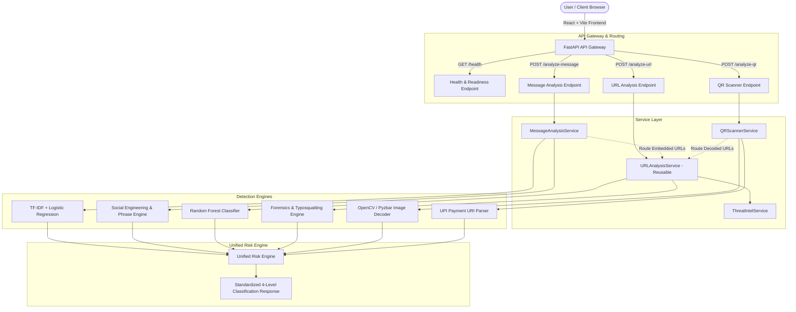
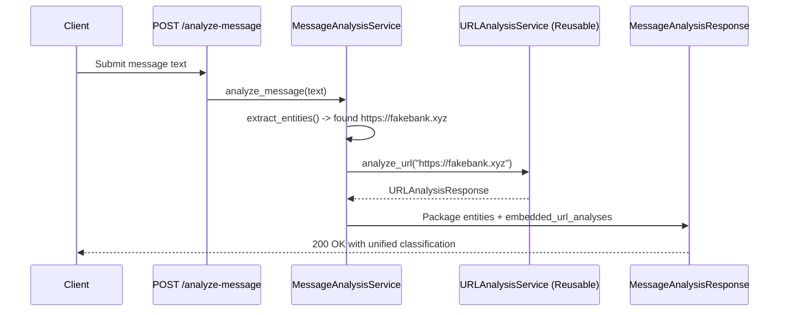

# FraudLens — System Architecture & Technical Specification

## 1. Executive Summary

**FraudLens** is a unified machine-learning-powered digital fraud detection platform engineered to protect users against deception across three major modern attack vectors:
1. **Scam Messages** (SMS, WhatsApp, email)
2. **Phishing URLs** (deceptive hostnames, lookalikes, typosquatting)
3. **Potentially Unsafe QR Codes** (obscured destinations, UPI payment manipulation)

Rather than treating these fraud channels in isolation or providing opaque numerical scores, FraudLens unifies them under an explainable, deterministic four-level risk taxonomy, accompanied by verifiable evidentiary indicators and actionable safety recommendations.

---

## 2. Unified 4-Level Risk Classification System

Across all three platform modules, the primary user-facing output must evaluate to exactly one of these four classifications:

| Classification | Meaning & Policy |
| :--- | :--- |
| **HIGH RISK** | Definitive evidence of malicious intent, high-confidence phishing patterns, known threat-feed matches, or coercive financial fraud indicators detected. |
| **MEDIUM RISK** | Anomalous or suspicious indicators detected (e.g., lookalike characters, urgency cues, unverified redirection) that warrant heightened caution. |
| **LOW RISK** | No recognized indicators of fraud, manipulation, or known risk observed during analysis. *(Note: Low risk is not an absolute guarantee of safety).* |
| **UNABLE TO VERIFY** | The input is incomplete, image unreadable, payload format unsupported, or external verification services unavailable. **Never defaults to safe.** |

### 2.1 Core Non-Claims & Architectural Guarantees
1. **Statistical Humility:** A machine learning model prediction is a probabilistic indicator, not judicial proof of fraud.
2. **Anomaly Discrimination:** An unusual pattern (e.g., unusual TLD or urgent wording in legitimate alerts) is not automatically malicious.
3. **Safety Realism:** A low-risk classification does not guarantee safety against novel zero-day threats.
4. **Honest Fail-Safe Default:** When upstream feeds fail, image decoding is inconclusive, or models are uninitialized, the system explicitly returns `UNABLE TO VERIFY`. It never produces misleading safety verdicts.

---

## 3. High-Level System Architecture

---

## 4. Final 15-Feature Specification Across Modules

### Module 1: Scam Message Detection
- **Core Model:** TF-IDF Vectorizer + Logistic Regression Classifier.
- **Sub-Features:**
  1. **ML-Based Scam Classification:** Classifies raw message text as scam or legitimate using trained model probabilities calibrated against test corpora.
  2. **Social Engineering Detection:** Rule-based detection of behavioral manipulation: artificial urgency, threat of account closure, authority impersonation, OTP/credential solicitation, prize bait, and payment coercion.
  3. **Suspicious Phrase Highlighting:** Deterministic character-offset highlighting of trigger phrases with clear warning rationale; explicitly separated from internal ML token weights.
  4. **Entity Extraction & Embedded URL Scanning:** Extracts URLs, telephone numbers, and UPI handles; pipes embedded URLs directly into `URLAnalysisService`.
  5. **Scam Type Identification:** Classifies recognized fraud categories (Bank/KYC scam, Delivery fraud, Job offer scam, Prize/Lottery bait, Investment fraud).

### Module 2: Phishing URL Detection
- **Core Model:** Random Forest Classifier.
- **Sub-Features:**
  1. **ML-Based Phishing Detection:** Classifies URLs via lexical and structural features (URL length, entropy, suspicious character counts, subdomains, token lengths).
  2. **Typosquatting & Brand Impersonation Detection:** Detects lookalike domains, homoglyph substitutions, and unauthorized prefix/suffix brand spoofing.
  3. **Domain & URL Forensics:** Structural breakdown of hostname, subdomain, registered domain, public suffix/TLD, path segments, and query parameters; flags direct IP address hosts.
  4. **Explainable Risk Indicators:** Categorizes signals into `MODEL_FEATURE`, `HEURISTIC`, and `CONFIRMED_EVIDENCE` for transparency.
    5. **Threat Intelligence & Reputation Lookup:** Integrates external reputation sources (VirusTotal, URLScan) with credential isolation and graceful offline fallback (`UNCONFIGURED` / `SERVICE_UNAVAILABLE`).

### Module 3: QR Code Safety Scanner
- **Core Technology:** OpenCV or Pyzbar + Phishing Engine Integration.
- **Sub-Features:**
  1. **QR Decoding & Payload Classification:** Computer vision payload decoding; classifies into Web URL, UPI Payment URI, Plain Text, or Unsupported.
  2. **Hidden Destination Preview:** Renders decoded payload text in a secure preview without automatic browser navigation or remote fetching.
  3. **Integrated Phishing URL Analysis:** Automatically passes extracted web URLs to `URLAnalysisService`.
  4. **UPI Payment Safety Inspection:** Parses `upi://pay` URI parameters (payee name `pn`, VPA `pa`, amount `am`, note `tn`); highlights mismatched or prepopulated amounts; makes zero claims of recipient endorsement.
  5. **Multi-QR Detection & Safe Error Handling:** Detects multiple QR codes, low-contrast/blurred images, and truncated barcodes; defaults to `UNABLE TO VERIFY` on decode failure.

---

## 5. Reusable Internal URL Service Pattern

To prevent architectural duplication, `URLAnalysisService` operates as a shared, standalone component within the FastAPI dependency graph:
- When a user submits a message to `POST /analyze-message`, `MessageAnalysisService` extracts embedded URLs and delegates their evaluation directly to `URLAnalysisService.analyze_url(...)`.
- When a user uploads a QR code to `POST /analyze-qr`, `QRScannerService` decodes the symbol and, if the payload is a web address, delegates evaluation to `URLAnalysisService.analyze_url(...)`.

---

## 6. Security Considerations & Hardening

1. **No Automatic URL Navigation / Remote Fetching:** The system parses lexical features and previews destinations offline; it never blindly follows redirects or fetches unverified third-party content without strict egress controls.
2. **Image Upload Safeguards:** `POST /analyze-qr` enforces a strict 5MB upload ceiling, checks magic bytes (PNG, JPEG, GIF, BMP, WEBP), and rejects empty or malformed files before computer vision processing.
3. **SSRF & Redirection Hardening:** Any planned live network probing will implement DNS pinning, disallow RFC 1918 private subnets (`10.0.0.0/8`, `172.16.0.0/12`, `192.168.0.0/16`, `127.0.0.0/8`), and enforce a 5-second connection timeout.
4. **Credential Isolation:** API keys for external intelligence providers are loaded strictly via environment variables (`.env`) and never exposed in client bundles or git histories.
5. **UPI Financial Non-Endorsement:** UPI parsing strictly verifies format syntax. It never initiates transactions, accesses bank accounts, or endorses payees.

---

## 7. Testing & Verification Architecture

- **Backend Unit & Contract Tests:** Implemented using `pytest` and FastAPI's `TestClient`.
  - `test_health.py`: Validates heartbeat, status metadata, and branding.
  - `test_contracts.py`: Validates schema conformance, input validation rejections (empty payloads, invalid formats), and enforces the 4 unified risk classifications.
  - `test_services.py`: Tests isolated component behaviors (domain forensics, entity extraction, fallback status).
- **Frontend Build & Type Safety:** Tested via `tsc -b` and `vite build` with Tailwind CSS integration and zero compilation warnings.
